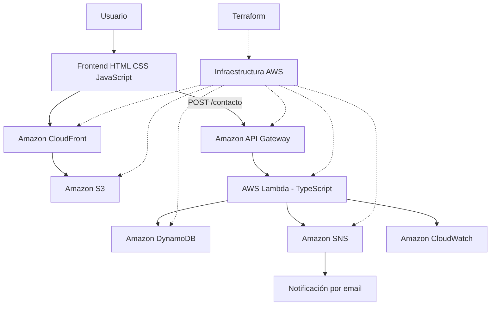

# Portfolio – Desarrollo Web e Infraestructura Cloud

Portfolio personal desarrollado para mostrar mis proyectos, conocimientos y evolución como desarrollador, aplicando tecnologías web y servicios de **Amazon Web Services (AWS)**.

El proyecto combina un frontend responsive con una arquitectura backend serverless desplegada en AWS. La infraestructura se gestiona mediante **Terraform**, buscando automatizar el aprovisionamiento de recursos y mantener una arquitectura organizada y escalable.

---

## Características principales

- Diseño responsive y adaptable a diferentes dispositivos.
- Interfaz con tema oscuro y acentos azules.
- Sección de presentación y perfil profesional.
- Apartado de formación y experiencia.
- Galería de proyectos y certificados.
- Sección de tecnologías y herramientas utilizadas.
- Formulario de contacto conectado a una API propia.
- Almacenamiento de mensajes en Amazon DynamoDB.
- Notificaciones mediante Amazon SNS.
- Distribución del frontend mediante Amazon CloudFront.
- Infraestructura definida como código mediante Terraform.

---

## Tecnologías utilizadas

### Frontend

- HTML5
- CSS3
- JavaScript
- Bootstrap 5.3

### Backend

- TypeScript
- Node.js
- npm
- esbuild

### Amazon Web Services

- **Amazon S3:** almacenamiento y alojamiento de los archivos estáticos del frontend.
- **Amazon CloudFront:** distribución de contenido y acceso al portfolio mediante HTTPS.
- **Amazon API Gateway:** exposición del endpoint HTTP para recibir los mensajes del formulario.
- **AWS Lambda:** ejecución de la lógica backend mediante funciones serverless.
- **Amazon DynamoDB:** almacenamiento de los mensajes recibidos.
- **Amazon SNS:** envío de notificaciones mediante correo electrónico.
- **AWS IAM:** gestión de roles y permisos entre los servicios.
- **Amazon VPC:** infraestructura de red definida mediante Terraform.
- **Amazon CloudWatch:** registros y seguimiento de la ejecución de Lambda.

### Infraestructura y herramientas

- Terraform
- AWS CLI
- Git
- GitHub

---

## Arquitectura del proyecto

El proyecto utiliza una arquitectura serverless para gestionar el formulario de contacto, evitando mantener un servidor backend permanentemente activo.

### Flujo del formulario de contacto

1. El usuario completa el formulario desde el frontend.
2. JavaScript recoge los datos y realiza una petición HTTP `POST`.
3. Amazon API Gateway recibe la petición a través de la ruta `/contacto`.
4. API Gateway invoca la función AWS Lambda.
5. Lambda valida los datos recibidos.
6. Los mensajes se almacenan en Amazon DynamoDB.
7. Lambda publica una notificación en Amazon SNS.
8. SNS envía la notificación a los suscriptores confirmados.
9. Lambda devuelve la respuesta a API Gateway y el frontend informa al usuario del resultado.

### Diagrama de arquitectura



---

## Estructura del repositorio
portafolio/
│
├── .gitignore
│
├── frontend/
│   │
│   ├── index.html
│   │
│   ├── css/
│   │   └── styles.css
│   │
│   ├── js/
│   │   └── main.js
│   │
│   ├── certificados/
│   │   └── certificado_fundamentos_de_javascript.pdf
│   │
│   └── img/
│       │
│       ├── foto.png
│       ├── icono.png
│       │
│       ├── proyectos/
│       │   └── portfolio.png
│       │
│       └── tecnologias/
│           │
│           ├── APIGateway.png
│           ├── Amplify.png
│           ├── CloudWatch.png
│           ├── GitHub.png
│           ├── HTML.png
│           ├── IAM.png
│           ├── Lambda.png
│           ├── OracleDatabase.png
│           ├── ReactNative.png
│           ├── S3.png
│           ├── SNS.png
│           ├── VPC.png
│           ├── aws.png
│           ├── bootstrap.png
│           ├── cloudfront.png
│           ├── css.png
│           ├── docker.png
│           ├── dynamodb.png
│           ├── ghactions.png
│           ├── git.png
│           ├── intellij.png
│           ├── java.png
│           ├── javascript.png
│           ├── junit.png
│           ├── linux.png
│           ├── mongodb.png
│           ├── nodejs.png
│           ├── php.png
│           ├── postgre.png
│           ├── sap.png
│           ├── terraform.png
│           ├── typescript.png
│           ├── virtualbox.png
│           └── vsc.png
│
├── backend/
│   │
│   └── lambda/
│       │
│       └── contact/
│           │
│           ├── src/
│           │   └── index.ts
│           │
│           ├── package.json
│           ├── package-lock.json
│           ├── tsconfig.json
│           └── sns-policy.json
│
└── infraestructura/
    │
    ├── .terraform.lock.hcl
    ├── api_gateway.tf
    ├── cloudfront.tf
    ├── dynamodb.tf
    ├── lambda.tf
    ├── main.tf
    ├── outputs.tf
    ├── provider.tf
    ├── s3.tf
    ├── variables.tf
    └── vpc.tf
---

## Infraestructura como código

La infraestructura se administra mediante Terraform, permitiendo definir los recursos de AWS mediante archivos `.tf`.

Entre las tareas que permite realizar se encuentran:

- Crear y administrar recursos de AWS.
- Definir las relaciones entre los servicios.
- Configurar permisos IAM.
- Gestionar la infraestructura mediante cambios controlados.
- Consultar los cambios antes de aplicarlos.

### Comandos principales

Inicializar Terraform:

```bash
terraform init
```

Comprobar la configuración:

```bash
terraform validate
```

Visualizar los cambios:

```bash
terraform plan
```

Aplicar los cambios:

```bash
terraform apply
```

Eliminar los recursos administrados por la configuración:

```bash
terraform destroy
```

> **Importante:** `terraform destroy` elimina los recursos administrados por la configuración. Debe utilizarse con precaución.

---

## Desarrollo local

### Requisitos

Antes de comenzar, es necesario disponer de:

- Git
- AWS CLI
- Terraform
- Node.js y npm
- Una cuenta de AWS con los permisos necesarios

### Clonar el repositorio

```bash
git clone https://github.com/jaledzd/portafolio.git
```

Acceder al proyecto:

```bash
cd portafolio
```

### Ejecutar el frontend

El frontend está compuesto por archivos estáticos HTML, CSS y JavaScript.

Puede abrirse mediante un servidor local de desarrollo o una extensión como Live Server de Visual Studio Code.

### Preparar el backend

Acceder a la carpeta de la función Lambda:

```bash
cd backend/lambda/contact
```

Instalar dependencias:

```bash
npm install
```

Generar el bundle de producción:

```bash
npm run build
```

El proceso genera el archivo JavaScript compilado que se utiliza para empaquetar y desplegar la función Lambda.

---

## Despliegue

### Frontend – Amazon S3

Los archivos del frontend se sincronizan con el bucket de S3:

```powershell
aws s3 sync .\frontend\ s3://NOMBRE_DEL_BUCKET --delete --profile portfolio
```

### Actualizar la distribución de CloudFront

Después de actualizar los archivos de S3, se puede invalidar la caché de CloudFront:

```powershell
aws cloudfront create-invalidation --distribution-id ID_DE_DISTRIBUCION --paths "/*" --profile portfolio
```

### Backend e infraestructura

El backend y los recursos de AWS se gestionan mediante Terraform y AWS CLI, según el tipo de modificación que se realice.

Los cambios en el código TypeScript requieren generar nuevamente el bundle y desplegar la versión actualizada de Lambda.

---

## Seguridad

La seguridad es una parte importante del desarrollo y despliegue del proyecto.

Se aplican o contemplan las siguientes medidas:

- Bloqueo del acceso público directo al bucket S3.
- Distribución del contenido mediante CloudFront.
- Uso de HTTPS para el acceso al frontend.
- Permisos IAM específicos para la comunicación entre servicios.
- Configuración CORS para permitir peticiones desde el dominio del portfolio.
- Limitación del tráfico de API Gateway mediante throttling.
- Gestión de variables de entorno en Lambda.
- Exclusión de archivos sensibles y credenciales mediante `.gitignore`.
- Gestión de infraestructura mediante Terraform.

---

## Objetivos de aprendizaje

Este proyecto también funciona como entorno práctico para profundizar en:

- Desarrollo frontend y backend.
- Programación con JavaScript y TypeScript.
- Arquitecturas serverless.
- Servicios de almacenamiento y distribución en AWS.
- Comunicación entre servicios cloud.
- Infraestructura como código.
- Automatización de despliegues.
- Seguridad y gestión de permisos en AWS.
- Control de versiones con Git y GitHub.

---

## Autor

**José Alejandro**

Desarrollador en formación, interesado en el desarrollo web, la programación backend y las tecnologías Cloud.

- GitHub: [@jaledzd](https://github.com/jaledzd)
- Portfolio: [Consultar portfolio](https://dpy515ar314pl.cloudfront.net)

---

*Proyecto personal desarrollado con fines de aprendizaje, experimentación y crecimiento profesional.*